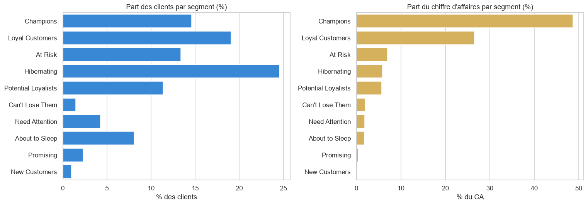
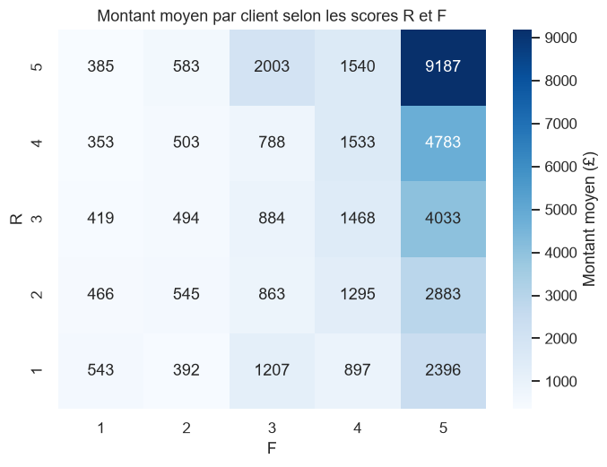

# 🛒 Segmentation Client RFM - Online Retail

## 📌 Présentation du projet
L'objectif de ce projet est de segmenter la base clients d'une entreprise de e-commerce en utilisant la méthode **RFM (Récence, Fréquence, Montant)**. Cette analyse permet de comprendre le comportement d'achat et de définir des stratégies marketing ciblées pour augmenter la rétention et le chiffre d'affaires.

**Données :** [Online Retail](https://archive.ics.uci.edu/dataset/352/online+retail), UCI Machine Learning Repository : 541 909 transactions d'un e-commerçant britannique (décembre 2010 à décembre 2011).

## 🛠️ Technologies utilisées
* **Python 3**
* **Pandas** : nettoyage et manipulation des données
* **Matplotlib & Seaborn** : visualisation des segments
* **Jupyter Notebook**

## 📊 Méthodologie
1. **Nettoyage des données** (27,5 % des lignes écartées) :
   - suppression des `CustomerID` manquants ;
   - filtrage des transactions annulées (factures commençant par « C ») ;
   - élimination des quantités et prix négatifs ou nuls, et des doublons.
2. **Calcul des métriques RFM** pour 4 338 clients :
   - **Récence** : nombre de jours depuis le dernier achat ;
   - **Fréquence** : nombre de commandes distinctes ;
   - **Montant** : chiffre d'affaires total généré.
3. **Scoring** : note de 1 à 5 pour chaque métrique, par quintiles.
4. **Segmentation** : correspondance des scores R et F avec 10 segments (Champions, Loyal Customers, At Risk, Hibernating…).

## 📈 Résultats clés
* **Données analysées :** 392 692 lignes, 4 338 clients, 18 532 commandes, 8,9 M£ de chiffre d'affaires.
* **Segment le plus nombreux :** *Hibernating*, avec 24,6 % des clients (peu actifs, peu récents).
* **Impact business :** les **Champions** représentent **14,6 % des clients mais 48,7 % du chiffre d'affaires**. Avec les *Loyal Customers*, **un tiers des clients génère 75 % du CA** : la fidélisation est prioritaire.
* **Alerte :** **14,8 % des clients** sont classés *At Risk* ou *Can't Lose Them* (9 % du CA) : ils nécessitent une campagne de réactivation immédiate.





## 🎯 Recommandations marketing
| Segment | Action recommandée |
|---|---|
| Champions | Programme VIP, avant-premières, demande d'avis et de parrainage |
| Loyal Customers | Offres de fidélité, ventes croisées |
| Potential Loyalists / Promising | Séquence d'e-mails de bienvenue, recommandations personnalisées |
| At Risk / Can't Lose Them | **Réactivation prioritaire** : offre personnalisée, contact direct pour les plus gros clients |
| About to Sleep / Need Attention | Relance avec une offre limitée dans le temps |
| Hibernating | Campagnes à faible coût, ou exclusion des envois |

## 📂 Structure du projet
```text
├── data/                     # données (non versionnées, voir ci-dessous)
├── output/                   # graphiques et export rfm_segments.csv
├── segmentation_rfm.ipynb    # notebook d'analyse complet
├── requirements.txt
└── README.md
```

## 🚀 Comment utiliser ce repo
1. Cloner le projet.
2. Installer les dépendances : `pip install -r requirements.txt`.
3. Télécharger les données sur [UCI](https://archive.ics.uci.edu/dataset/352/online+retail) et placer `Online Retail.xlsx` dans `data/`.
4. Lancer le notebook `segmentation_rfm.ipynb`.

## 👨‍💻 Auteur
Youssef Achou, [Synerbyte Technologies](https://synerbyte.eu) · [LinkedIn](https://www.linkedin.com/in/youssef-achou-5218a83b9)
